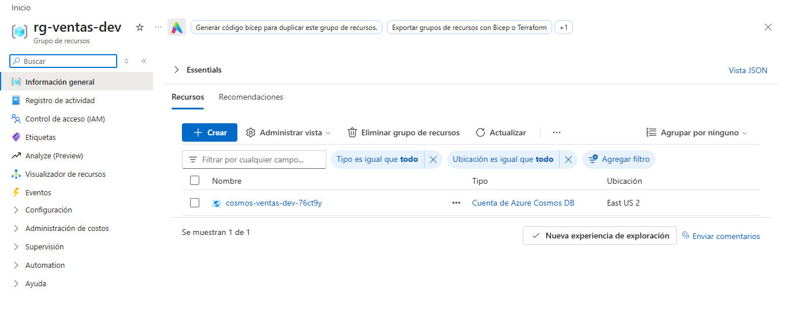
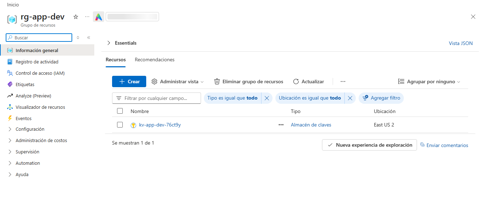
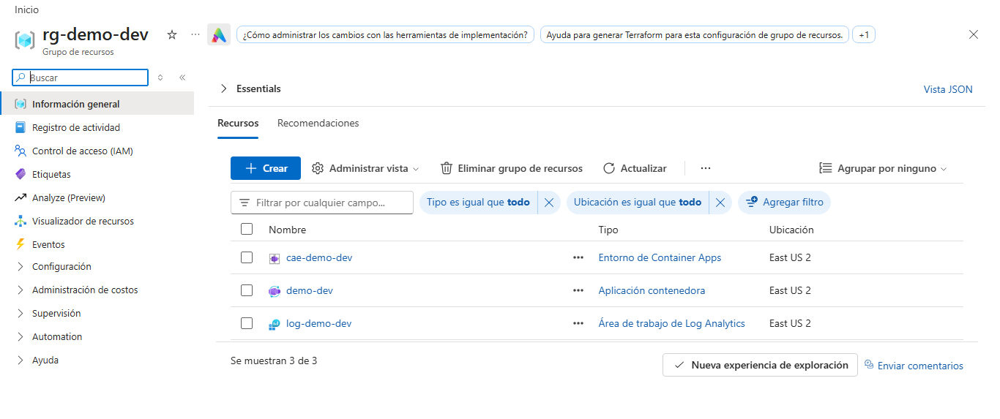
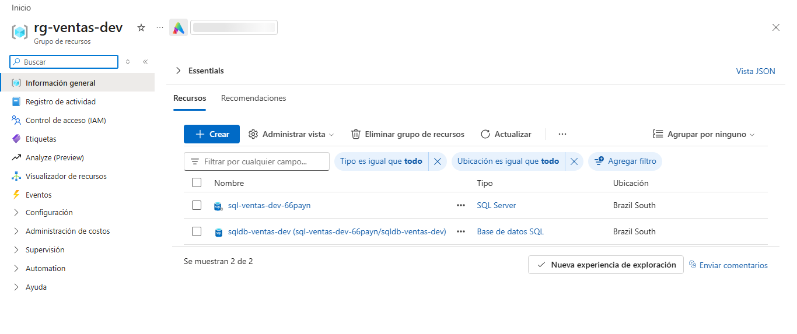
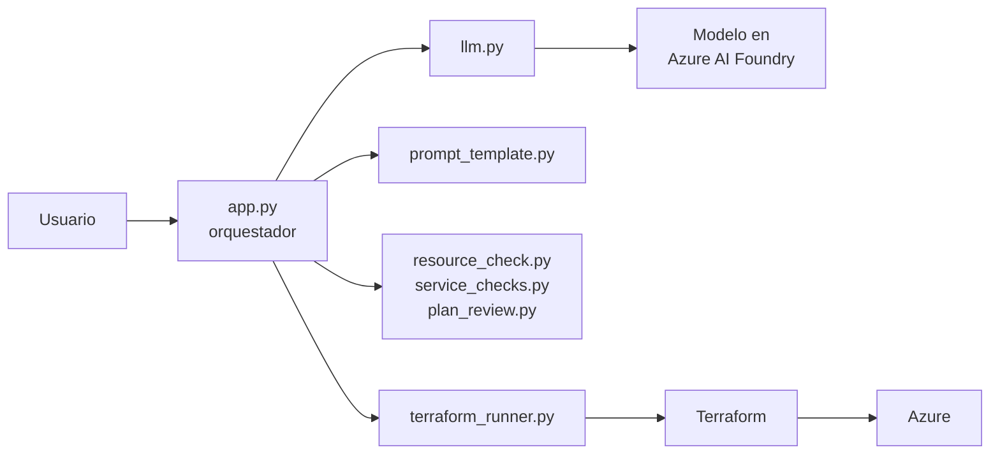
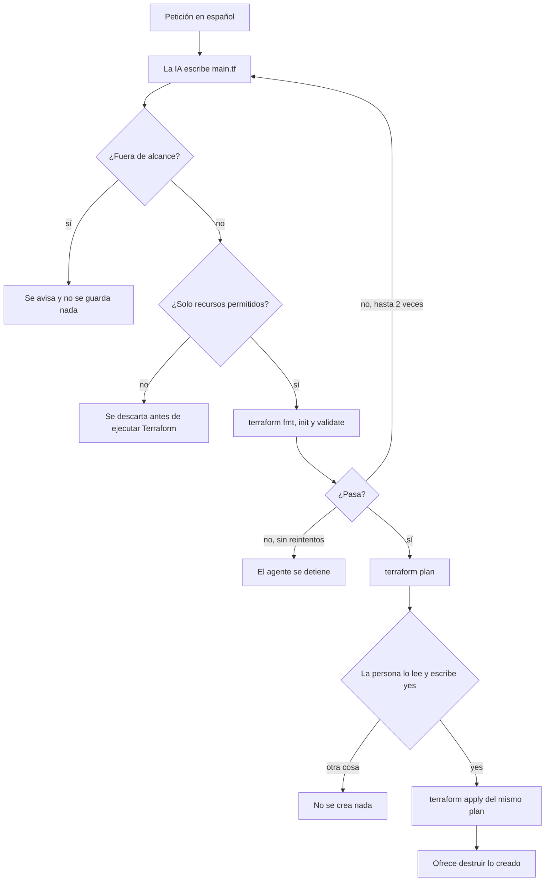

# Agent-IaC-Terraform

Agente que convierte una petición en español en código de Terraform para Azure. Es la versión
con Terraform de `Agent-IaC` (que genera Bicep).

> **Idea central:** la IA solo propone código. Nunca se despliega nada sin que una persona
> lea el `terraform plan` y escriba `yes`.

```text
> Crea un grupo de recursos en East US y un almacenamiento privado para copias de seguridad
```

La IA escribe el `main.tf`, el agente lo revisa y lo valida, te muestra el plan y, solo si
confirmas, lo aplica en Azure.

## Alcance del MVP

| Dentro | Fuera |
|---|---|
| Un grupo de recursos y, según la petición, una cuenta de almacenamiento, una red básica (red virtual, subred y NSG), Azure SQL (nivel Basic), Cosmos DB (free tier), Key Vault, una máquina virtual Linux (sin IP pública), App Service (Linux) y/o Container Apps, desde una frase en español | APIM, Kubernetes, máquinas Windows, otras bases de datos y reglas de red o de firewall personalizadas |
| Generar `main.tf` en una carpeta de salida | Estado remoto en Azure Storage |
| Validar con `terraform fmt`, `validate` y `plan`; interfaz web local (chat, pasos, plan y botones de confirmación) | Varios usuarios a la vez (el front admite una sola ejecución) |
| Mostrar el plan y pedir confirmación antes del `apply` | Despliegue automático sin revisión |
| Destruir lo creado con una confirmación escrita | Varios entornos (dev, test, prod) |

## Qué está verificado en Azure real

Probado el 20 de octubre de 2026 en una suscripción gratuita, un servicio a la vez y
destruyendo al terminar. El detalle está en [`docs/informe-pruebas-azure.md`](docs/informe-pruebas-azure.md).

| Servicio | Estado | Comprobado |
|---|---|---|
| Grupo de recursos y almacenamiento | Verificado | Creación y destrucción (ver ejemplo de ejecución) |
| Cosmos DB | Verificado | Free tier activo y una sola región |
| Key Vault | Verificado | Acceso por roles (RBAC), sin protección contra purga, SKU standard |
| Container Apps | Verificado | Imagen de `mcr.microsoft.com`, 0.25 CPU, 0.5Gi, 1 réplica, tope de logs 0.5 GB/día |
| Azure SQL | Verificado | Usuario `sqladmin`, TLS 1.2, base Basic de 2 GB (en `brazilsouth`; `eastus2` rechazó el servidor) |
| Red básica | Verificado | Red virtual, subred, NSG, asociación e interfaz creadas |
| App Service | Bloqueado por la suscripción | Cuota 0 para F1 y B1; el código pasó `validate` y `plan` |
| Máquina virtual | Bloqueada por la suscripción | `SkuNotAvailable` para Standard_B1s en `eastus2` y `brazilsouth`; la red sí se creó |

"Bloqueado" significa que Azure rechazó la operación por cuota o capacidad de esa suscripción;
el mismo rechazo se obtuvo con la CLI de Azure sin pasar por el agente (App Service).

Capturas del portal con lo que el agente creó:

| Cosmos DB | Key Vault |
|---|---|
|  |  |

| Container Apps | Azure SQL |
|---|---|
|  |  |

## Arquitectura



El orquestador (`app.py`) es el único que habla con los demás: le pasa la frase a la IA,
guarda el código que devuelve y ejecuta Terraform. Solo Terraform toca Azure, con tu sesión
de `az login`. La IA nunca recibe credenciales de Azure.

## Flujo de una petición



## Barreras de seguridad

El código lo escribe una IA, que puede equivocarse o inventar cosas. Entre su respuesta y Azure
hay seis barreras, en este orden:

| # | Barrera | Qué detiene | Dónde |
|---|---|---|---|
| 1 | Alcance del prompt y `FUERA_DE_ALCANCE` | Peticiones que piden otros recursos | `prompt_template.py`, `app.py` |
| 2 | Limpieza del texto | Marcas de markdown alrededor del código | `app.py` |
| 3 | Lista cerrada | Todo lo que no sea `terraform`, `provider "azurerm"` y los recursos permitidos (grupo de recursos, cuenta de almacenamiento, red virtual, subred, NSG con su asociación, servidor y base de datos Azure SQL, Cosmos DB, Key Vault, interfaz de red y máquina virtual Linux, plan y aplicación de App Service, Log Analytics y Container Apps, más `random_string` y `random_password`; el único `data` permitido es `azurerm_client_config`); también `module`, `locals`, `provisioner`, `backend`, reglas de seguridad personalizadas (`security_rule`), heredocs, funciones que leen archivos y más de 20 recursos | `resource_check.py` |
| 4 | Nombres, rangos y reglas por servicio, `terraform fmt`, `init` y `validate` | Código mal escrito, nombres que Azure rechazaría, rangos de IP inválidos, públicos o solapados, y servicios fuera de sus límites de costo y seguridad; el error vuelve al modelo, máximo 2 reintentos | `resource_check.py`, `service_checks.py`, `terraform_runner.py` |
| 5 | `terraform plan` revisado | Cambios o destrucciones inesperados y recursos fuera de la lista | `plan_review.py`, tú |
| 6 | Confirmación escrita | `apply` sin permiso: solo vale la palabra `yes` completa | `app.py` |

Reglas de implementación:

- Los comandos se ejecutan con una lista de argumentos y sin `shell=True`: ningún texto del
  modelo ni del usuario se interpreta como un comando.
- Nunca se usa `-auto-approve`. El `apply` aplica el plan guardado (`plan.tfplan`) que la
  persona acaba de leer, no uno nuevo.
- Si un `apply` falla a medias, el agente muestra lo que quedó creado y ofrece destruirlo,
  con la misma confirmación escrita.
- Terraform no recibe las variables `AZURE_AI_*` (la clave del modelo).
- La clave del modelo va en el `.env`, nunca en el código ni en Git. El estado de Terraform
  y los planes guardados están en el `.gitignore`.

## Estructura

| Archivo | Responsabilidad |
|---|---|
| `app.py` | Orquestador: flujo completo, reintentos, confirmación, región alterna y contraseñas |
| `events.py` | Canal de salida: todo lo que el agente cuenta pasa por `emit()` (consola y front) |
| `server.py` | Servidor del front (FastAPI + WebSocket): ejecuta el agente y espera tu clic en cada confirmación |
| `static/index.html` | Página del front: chat, pasos, código, plan y botones |
| `config.py` | Variables de entorno y carpeta de trabajo (`AGENT_OUTPUT_DIR`) |
| `Dockerfile` | Imagen para Azure Container Apps (ver [`docs/despliegue-container-apps.md`](docs/despliegue-container-apps.md)) |
| `llm.py` | Única función que habla con el modelo; cambiar de proveedor solo toca este archivo |
| `prompt_template.py` | Instrucciones del sistema para la IA |
| `resource_check.py` | Lista cerrada de lo que puede contener el código generado |
| `service_checks.py` | Reglas de costo y seguridad de Cosmos DB, Key Vault, VM, App Service y Container Apps |
| `plan_review.py` | Lee el `plan`: advierte ante cambios o destrucciones y bloquea recursos no permitidos |
| `regions.py` | Detección de errores de región y cambio de región |
| `terraform_runner.py` | Ejecuta fmt, init, validate, plan, apply (del plan guardado) y estado |
| `output/` | Carpeta de trabajo de Terraform: `main.tf` y estado (fuera de Git) |
| `tests/` | Pruebas con un modelo y un Terraform falsos |
| `docs/` | Informe de pruebas, evidencia de ejecuciones y capturas del portal |

## Puesta en marcha

Requisitos: Python 3.10 o superior, [Terraform](https://developer.hashicorp.com/terraform/install)
1.6 o superior, Azure CLI y un modelo de chat desplegado en Azure AI Foundry.

```powershell
python -m venv venv
.\venv\Scripts\Activate.ps1
pip install -r requirements.txt
copy .env.example .env     # y completar los valores
az login
python app.py
```

Variables del `.env` (el `.env.example` solo trae los nombres):

| Variable | Qué es |
|---|---|
| `ARM_SUBSCRIPTION_ID` | ID de tu suscripción de Azure (la v4 de `azurerm` lo exige) |
| `AZURE_AI_ENDPOINT` | `https://<recurso>.openai.azure.com/` |
| `AZURE_AI_DEPLOYMENT` | Nombre del **despliegue del modelo** (no el de un agente de Foundry) |
| `AZURE_AI_API_KEY` | Clave del recurso |
| `AZURE_FALLBACK_REGIONS` | Opcional. Regiones alternas separadas por comas; reemplaza la lista por defecto |

Algunos servicios necesitan registrar su proveedor una sola vez por suscripción. Por ejemplo,
Container Apps requiere `Microsoft.App`:

```powershell
az provider register --namespace Microsoft.App
az provider show -n Microsoft.App --query registrationState -o tsv   # debe decir Registered
```

## Uso

En el prompt `>` describe lo que quieres. Enter vacío para salir. Escribe `destroy` para
destruir lo que el agente haya creado y `secretos` para ver las contraseñas generadas.

| Petición | Resultado |
|---|---|
| `Crea un grupo de recursos en East US y un almacenamiento privado para copias de seguridad` | Genera el código, pasa la validación y muestra el plan: 3 recursos a crear |
| `Crea una cuenta Cosmos DB con una base de datos llamada ventas` | Cuenta con free tier y una región |
| `Crea una base de datos SQL llamada ventas en brazilsouth` | Servidor y base Basic con contraseña generada |
| `Crea una aplicación en Container Apps para el entorno dev` | Log Analytics, entorno y aplicación con imagen de MCR |
| `Crea un APIM` | Responde que está fuera de alcance y no guarda nada |

Si no indicas entorno, usa `dev`. Si no indicas región, usa `eastus2`; la región se puede pedir
en la frase. El nombre de varios recursos lleva un sufijo aleatorio de 6 caracteres para no
chocar con otros de Azure.

**Antes de pedir algo nuevo, ejecuta `destroy` y confirma que no queda nada.** Si el estado de
Terraform aún contiene recursos de una petición anterior y el modelo cambia los nombres, el
plan destruirá lo viejo y creará lo nuevo a la vez, y Azure puede rechazar el nombre repetido.
El plan lo avisa con una advertencia de destrucción: si la ves en una creación nueva,
cancela.

## Interfaz web

Lo mismo que la terminal, en el navegador y mostrando lo que pasa por dentro:

```powershell
pip install -r requirements.txt
python server.py          # abre http://127.0.0.1:8000
```

- **Izquierda:** el chat. Tus peticiones, los avisos del agente y las confirmaciones con botones
  (**Crear en Azure**, **Destruir**, **Cambiar región**). Solo cuenta un clic explícito: si cierras
  la página mientras espera una confirmación, se cancela.
- **Derecha:** los pasos (Modelo, Validar, Plan, Aplicar) con su estado, la **consola de logs**,
  el **código Terraform** generado y el **plan** coloreado.
- Escribir `destroy` o `secretos` en el chat funciona como en la terminal; también están los
  botones de la barra superior. Las contraseñas salen ocultas, con botones Mostrar y Copiar, y
  no se guardan en el historial de la página.
- Usa el mismo `.env` y el mismo `az login` que la terminal: **pedir algo crea recursos reales**.

Variables opcionales del servidor:

| Variable | Qué es |
|---|---|
| `HOST` y `PORT` | Dónde escucha. Por defecto `127.0.0.1:8000` (solo tu equipo) |
| `ACCESS_TOKEN` | Clave para abrir la página (`/?token=...`). **Obligatoria** si `HOST` no es local: sin ella el servidor no arranca |
| `AGENT_OUTPUT_DIR` | Carpeta de trabajo (`main.tf` y estado de Terraform). Por defecto `output/` |

El servidor rechaza conexiones que no vengan de su propia página (para que otro sitio abierto
en tu navegador no pueda darle órdenes) y ejecuta una sola cosa a la vez. Para llevarlo a Azure
Container Apps, ver [`docs/despliegue-container-apps.md`](docs/despliegue-container-apps.md).

## Ejemplo de una ejecución real

Petición, plan, confirmación, creación y destrucción, de punta a punta:
[`docs/ejemplo-ejecucion.txt`](docs/ejemplo-ejecucion.txt) (con el ID de suscripción y las
rutas personales reemplazados).

Resumen de esa ejecución:

```text
Plan: 3 to add, 0 to change, 0 to destroy.
Escribe yes para crear; cualquier otra cosa cancela: yes
...
Apply complete! Resources: 3 added, 0 changed, 0 destroyed.
...
Plan: 0 to add, 0 to change, 3 to destroy.
Escribe yes para destruir; cualquier otra cosa cancela: yes
...
Apply complete! Resources: 0 added, 0 changed, 3 destroyed.
```

Mientras existían, el portal de Azure mostraba el grupo de recursos con su cuenta de almacenamiento:


## Costos

| Concepto | Costo | Nota |
|---|---|---|
| Grupo de recursos | Gratis | |
| Cuenta de almacenamiento LRS vacía | Centavos al mes | Se destruye al terminar cada prueba |
| Base de datos Azure SQL (Basic) | Cobra por hora mientras exista | El plan lo avisa con 💲; destrúyela al terminar. Revisa el precio vigente en Azure |
| Máquina virtual (B1s/B1ms/B2s) | Cobra por hora; el disco cobra aunque esté apagada | Solo tamaños B y disco Standard |
| App Service | F1 es gratis; B1 cobra por hora | Solo F1 o B1 |
| Cosmos DB | Gratis con free tier | Azure permite una cuenta gratis por suscripción |
| Container Apps + Log Analytics | Por uso | CPU ≤ 0.5, memoria ≤ 1Gi, máx. 2 réplicas, tope diario de logs de 1 GB |
| Key Vault | Centavos por operaciones | Al destruirlo queda en borrado suave y su nombre sigue reservado unos días |
| Llamadas al modelo de IA | Depende del modelo | Revisa el precio vigente del modelo que despliegues en Foundry |

Lo único que gasta crédito es el `apply`. `fmt`, `init` y `validate` no se conectan a Azure, y
el `plan` solo lee. Al terminar cada prueba, destruye lo creado (el agente lo ofrece) y
comprueba con `az group list -o table`. Azure puede mostrar además `NetworkWatcherRG`, que crea
solo al usar redes virtuales y no pertenece al agente.

## Servicios y sus límites

Cada servicio tiene reglas propias en `service_checks.py`; si el modelo se sale de ellas, el
error vuelve al modelo (hasta 2 reintentos) antes de llegar a Azure.

| Servicio | Reglas |
|---|---|
| Cosmos DB | `free_tier_enabled = true`, una sola región, sin throughput ni escrituras múltiples |
| Key Vault | Acceso por roles (RBAC), sin `access_policy`, sin protección contra purga |
| Máquina virtual | Ubuntu de Canonical, tamaños B, disco Standard, sin IP pública, contraseña de `random_password` |
| App Service | Linux, plan F1 o B1, solo HTTPS |
| Container Apps | Solo imágenes de `mcr.microsoft.com/`, sin secretos, registros ni identidad |

Una máquina virtual sin IP pública no es accesible desde internet: para entrar tendrías que
añadir una puerta de entrada (Bastion, VPN) fuera de este agente.

## Región alterna

Si el `apply` falla por un problema de la región (disponibilidad, cuota o política de la
suscripción; es habitual con Azure SQL), el agente:

1. ofrece destruir lo que haya quedado a medias (con `yes` escrito);
2. propone la siguiente región de una lista controlada **por el código**, nunca por el modelo
   (`eastus2, brazilsouth, swedencentral, centralus, westus2, westus3, southcentralus`; se
   cambia con `AZURE_FALLBACK_REGIONS=region1,region2` en el `.env`);
3. pide otro `yes` escrito para cambiar de región, porque los datos quedarían en ella;
4. reescribe solo los `location = "..."` fijos de `main.tf` y vuelve a hacer el plan completo
   para que lo revises y confirmes de nuevo.

Máximo 2 cambios por intento. Si el error no parece de región, no se ofrece cambiarla. En las
pruebas reales, la región se pidió directamente en la frase (por ejemplo, `en brazilsouth`).

## Contraseñas generadas

Para Azure SQL y la máquina virtual, Terraform genera la contraseña con `random_password`; el
modelo nunca la ve ni la escribe. Al terminar el `apply` el agente la muestra una vez y puedes
verla otra vez con el comando `secretos` mientras existan los recursos.

Ten en cuenta que:

- Queda en texto plano en `output/terraform.tfstate` (ya está en `.gitignore`). No subas ni
  sincronices la carpeta `output/`.
- No está ligada a tu cuenta de Azure: quien tenga el estado o la contraseña tiene acceso.
- No grabes la pantalla ni publiques GIFs con la contraseña visible.
- Al destruir los recursos, la contraseña deja de existir.
- No se crean reglas de firewall: para conectarte a SQL tendrás que añadir tu IP desde el portal.

## Limitaciones conocidas

- **Límites de la suscripción.** En la prueba real, App Service tuvo cuota 0 (F1 y B1) y la VM
  Standard_B1s no tuvo capacidad en `eastus2` ni `brazilsouth`. Azure SQL rechazó `eastus2`.
  Son límites de la cuenta, no del agente; pueden variar según la suscripción.
- **Estado no vacío entre peticiones.** Ver la nota en "Uso": ejecuta `destroy` entre pruebas.
- **El modelo puede usar `locals`.** La lista cerrada lo rechaza antes de tocar Azure; suele
  bastar con repetir la petición.
- **"Privado" es parcial.** El código fija `allow_nested_items_to_be_public = false`, que impide
  el acceso anónimo a los blobs, pero el endpoint de la cuenta sigue siendo accesible desde
  internet (`public_network_access_enabled = true`, el valor por defecto). El prompt prohíbe
  `public_network_access_enabled = false` porque puede impedir que Terraform cree o lea la
  cuenta; cerrar la red del todo queda como mejora y hay que probarlo aparte.
- **El estado es local** (`output/terraform.tfstate`). Si lo borras con recursos creados,
  Terraform ya no sabe que existen. Escribe `destroy` antes de tocar esa carpeta.
- **Una sola carpeta de trabajo.** Una petición nueva se planea contra el estado existente: si
  ya hay recursos creados, el plan puede modificarlos o destruirlos, y el agente lo advierte.
- **Azure SQL sin Entra ID.** Se usa usuario y contraseña generada por simplicidad; en un entorno real conviene autenticación con Entra ID.
- **Azure puede responder con retraso.** Tras crear recursos, alguna consulta o un `destroy`
  inmediato pueden fallar con un 404 transitorio; reintentar un minuto después suele bastar.
- **La IA no es determinista.** El mismo pedido puede producir nombres de recursos o
  formato distintos entre ejecuciones; por eso se valida y se muestra el plan siempre.
- **El front es de una sola persona.** Ejecuta una cosa a la vez y guarda el historial en memoria
  (se pierde al reiniciar el servidor; el estado de Terraform no). Las contraseñas aparecen en
  pantalla: no compartas ni grabes la pantalla en ese momento.
- **El despliegue en Container Apps está documentado pero no probado.** La guía separa qué
  comandos se verificaron en la documentación oficial y cuáles hay que probar.

## Pruebas

```powershell
python -m unittest discover -s tests -v
```

Usan un modelo y un Terraform falsos: no consumen crédito, no necesitan Terraform instalado y
no tocan Azure. Cubren la lista cerrada, el reintento con el error, que solo `yes` aplique y
que `apply` nunca se ejecute sin confirmación. Un pipeline de GitHub Actions
(`.github/workflows/tests.yml`) las corre en cada push y pull request.

## Estado

Verificados en Azure real: grupo de recursos, almacenamiento, red básica, Cosmos DB, Key Vault,
Container Apps y Azure SQL. Pendientes: App Service y máquina virtual (bloqueados por la
suscripción), evitar el choque de nombres con estado no vacío y ampliar la detección de errores
de región. La interfaz web se probó en local creando una cuenta de almacenamiento; el
despliegue en Container Apps está documentado y sin probar. Ideas siguientes: cerrar la red de
la cuenta, estado remoto y más tipos de recurso (siempre con lista cerrada).