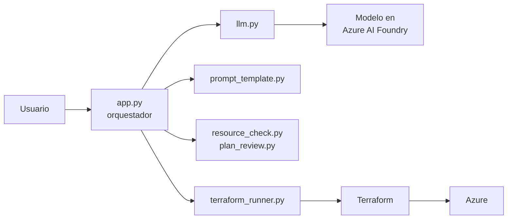
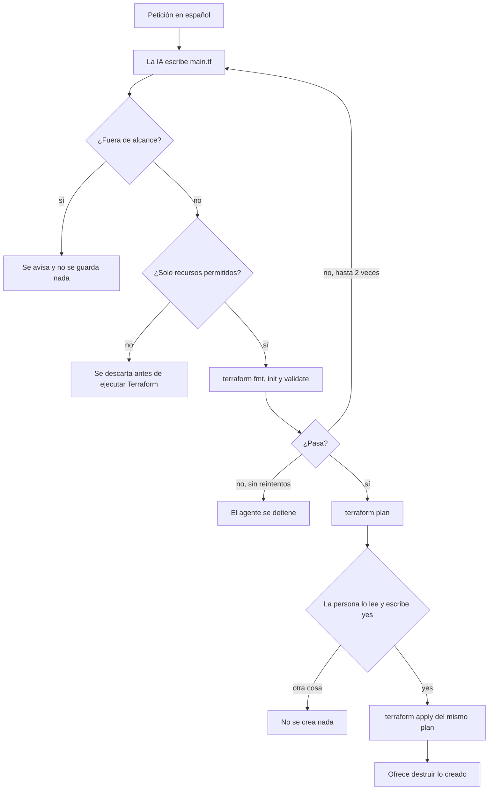

# Agent-IaC-Terraform

Agente que convierte una petición en español en código de Terraform para Azure. Es la versión
con Terraform de `Agent-IaC` (que genera Bicep).

> **Idea central:** la IA solo propone código. Nunca se despliega nada sin que una persona
> lea el `terraform plan` y escriba `yes`.

```text
> Crea un grupo de recursos en East US y un almacenamiento privado para copias de seguridad
```

La IA escribe el `main.tf`, el agente lo revisa y lo valida, te muestra el plan y, solo si
confirmas, lo aplica en Azure.

## Alcance del MVP

| Dentro | Fuera |
|---|---|
| Un grupo de recursos y una cuenta de almacenamiento, desde una frase en español | Redes, bases de datos y máquinas virtuales |
| Generar `main.tf` en una carpeta de salida | Estado remoto en Azure Storage |
| Validar con `terraform fmt`, `validate` y `plan` | Interfaz web (FastAPI) |
| Mostrar el plan y pedir confirmación antes del `apply` | Despliegue automático sin revisión |
| Destruir lo creado con una confirmación escrita | Varios entornos (dev, test, prod) |

## Arquitectura



El orquestador (`app.py`) es el único que habla con los demás: le pasa la frase a la IA,
guarda el código que devuelve y ejecuta Terraform. Solo Terraform toca Azure, con tu sesión
de `az login`. La IA nunca recibe credenciales de Azure.

## Flujo de una petición



## Barreras de seguridad

El código lo escribe una IA, que puede equivocarse o inventar cosas. Entre su respuesta y Azure
hay seis barreras, en este orden:

| # | Barrera | Qué detiene | Dónde |
|---|---|---|---|
| 1 | Alcance del prompt y `FUERA_DE_ALCANCE` | Peticiones que piden otros recursos | `prompt_template.py`, `app.py` |
| 2 | Limpieza del texto | Marcas de markdown alrededor del código | `app.py` |
| 3 | Lista cerrada | Todo lo que no sea `terraform`, `provider "azurerm"` y los recursos `azurerm_resource_group`, `azurerm_storage_account` y `random_string`; también `module`, `data`, `provisioner`, `backend`, heredocs y funciones que leen archivos | `resource_check.py` |
| 4 | `terraform fmt`, `init` y `validate` | Código mal escrito; el error vuelve al modelo, máximo 2 reintentos | `terraform_runner.py` |
| 5 | `terraform plan` revisado | Cambios o destrucciones inesperados y recursos fuera de la lista | `plan_review.py`, tú |
| 6 | Confirmación escrita | `apply` sin permiso: solo vale la palabra `yes` completa | `app.py` |

Reglas de implementación:

- Los comandos se ejecutan con una lista de argumentos y sin `shell=True`: ningún texto del
  modelo ni del usuario se interpreta como un comando.
- Nunca se usa `-auto-approve`. El `apply` aplica el plan guardado (`plan.tfplan`) que la
  persona acaba de leer, no uno nuevo.
- Terraform no recibe las variables `AZURE_AI_*` (la clave del modelo).
- La clave del modelo va en el `.env`, nunca en el código ni en Git. El estado de Terraform
  y los planes guardados están en el `.gitignore`.

## Estructura

| Archivo | Responsabilidad |
|---|---|
| `app.py` | Orquestador: flujo completo, reintentos y confirmación |
| `llm.py` | Única función que habla con el modelo; cambiar de proveedor solo toca este archivo |
| `prompt_template.py` | Instrucciones del sistema para la IA |
| `resource_check.py` | Lista cerrada de lo que puede contener el código generado |
| `plan_review.py` | Lee el `plan`: advierte ante cambios o destrucciones y bloquea recursos no permitidos |
| `terraform_runner.py` | Ejecuta fmt, init, validate, plan, apply (del plan guardado) y estado |
| `output/` | Carpeta de trabajo de Terraform: `main.tf` y estado (fuera de Git) |
| `tests/` | Pruebas con un modelo y un Terraform falsos |
| `docs/` | Evidencia de una ejecución real |

## Puesta en marcha

Requisitos: Python 3.10 o superior, [Terraform](https://developer.hashicorp.com/terraform/install)
1.6 o superior, Azure CLI y un modelo de chat desplegado en Azure AI Foundry.

```powershell
python -m venv venv
.\venv\Scripts\Activate.ps1
pip install -r requirements.txt
copy .env.example .env     # y completar los valores
az login
python app.py
```

Variables del `.env` (el `.env.example` solo trae los nombres):

| Variable | Qué es |
|---|---|
| `ARM_SUBSCRIPTION_ID` | ID de tu suscripción de Azure (la v4 de `azurerm` lo exige) |
| `AZURE_AI_ENDPOINT` | `https://<recurso>.openai.azure.com/` |
| `AZURE_AI_DEPLOYMENT` | Nombre del **despliegue del modelo** (no el de un agente de Foundry) |
| `AZURE_AI_API_KEY` | Clave del recurso |

## Uso

En el prompt `>` describe lo que quieres. Enter vacío para salir. Escribe `destroy` para
destruir lo que el agente haya creado.

| Petición | Resultado |
|---|---|
| `Crea un grupo de recursos en East US y un almacenamiento privado para copias de seguridad` | Genera el código, pasa la validación y muestra el plan: 3 recursos a crear |
| `Crea una máquina virtual` | Responde que está fuera de alcance y no guarda nada |

Si no indicas entorno, usa `dev`. El nombre de la cuenta de almacenamiento siempre lleva un
sufijo aleatorio de 6 caracteres para no chocar con otras cuentas de Azure.

## Ejemplo de una ejecución real

Petición, plan, confirmación, creación y destrucción, de punta a punta:
[`docs/ejemplo-ejecucion.txt`](docs/ejemplo-ejecucion.txt) (con el ID de suscripción y las
rutas personales reemplazados).

Resumen de esa ejecución:

```text
Plan: 3 to add, 0 to change, 0 to destroy.
Escribe yes para crear; cualquier otra cosa cancela: yes
...
Apply complete! Resources: 3 added, 0 changed, 0 destroyed.
...
Plan: 0 to add, 0 to change, 3 to destroy.
Escribe yes para destruir; cualquier otra cosa cancela: yes
...
Apply complete! Resources: 0 added, 0 changed, 3 destroyed.
```

Mientras existían, el portal de Azure mostraba el grupo de recursos con su cuenta de almacenamiento:


## Costos

| Concepto | Costo | Nota |
|---|---|---|
| Grupo de recursos | Gratis | |
| Cuenta de almacenamiento LRS vacía | Centavos al mes | Se destruye al terminar cada prueba |
| Llamadas al modelo de IA | Depende del modelo | Revisa el precio vigente del modelo que despliegues en Foundry |

Lo único que gasta crédito es el `apply`. `fmt`, `init` y `validate` no se conectan a Azure, y
el `plan` solo lee. Al terminar cada prueba, destruye lo creado (el agente lo ofrece) y
comprueba con `az group list -o table`.

## Limitaciones conocidas

- **"Privado" es parcial.** El código fija `allow_nested_items_to_be_public = false`, que impide
  el acceso anónimo a los blobs, pero el endpoint de la cuenta sigue siendo accesible desde
  internet (`public_network_access_enabled = true`, el valor por defecto, como se ve en el plan
  de la ejecución de ejemplo). El prompt prohíbe `public_network_access_enabled = false` porque
  puede impedir que Terraform cree o lea la cuenta; cerrar la red del todo queda como mejora y
  hay que probarlo aparte.
- **El estado es local** (`output/terraform.tfstate`). Si lo borras con recursos creados,
  Terraform ya no sabe que existen. Escribe `destroy` antes de tocar esa carpeta.
- **Una sola carpeta de trabajo.** Una petición nueva se planea contra el estado existente: si
  ya hay recursos creados, el plan puede modificarlos o destruirlos, y el agente lo advierte.
- **La IA no es determinista.** El mismo pedido puede producir nombres de recursos o
  formato distintos entre ejecuciones; por eso se valida y se muestra el plan siempre.

## Pruebas

```powershell
python -m unittest discover -s tests -v
```

Usan un modelo y un Terraform falsos: no consumen crédito, no necesitan Terraform instalado y
no tocan Azure. Cubren la lista cerrada, el reintento con el error, que solo `yes` aplique y
que `apply` nunca se ejecute sin confirmación. Un pipeline de GitHub Actions
(`.github/workflows/tests.yml`) las corre en cada push y pull request.

## Estado

Fases 0 a 4 del plan de construcción completas. Ideas siguientes: cerrar la red de la cuenta,
estado remoto, interfaz web con FastAPI y más tipos de recurso (siempre con lista cerrada).